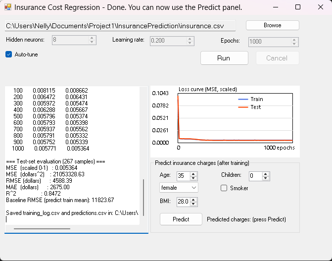

<div align="center">

# Insurance Charges Prediction
### Regression with a Custom Multi-Layer Perceptron in C#

A from-scratch 3-layer neural network (input, hidden, output) with backpropagation, trained to predict individual medical insurance charges.


</div>

---

## About the Project

This project applies our custom C# neural network engine (the `Backprop` library: `INeuron`, `HNeuron`, `ONeuron`, `NeuralNet`) to a real-world regression problem: predicting a person's yearly medical insurance **charges** from demographic and lifestyle attributes. It is a Windows Forms app that loads the CSV, tunes and trains the network, plots the loss curve, reports test-set metrics and predicts charges for a new person.
 
<div align="center">
  
</div>

**Task type:** Regression

---

## Dataset

**File:** `insurance.csv`  
**Size:** 1,338 records, 7 columns, no missing values.

| Column | Type | Description | Used as input |
|---|---|---|---|
| `age` | integer | Age of the primary beneficiary (18-64) | Yes |
| `sex` | categorical | `male` or `female` | Yes |
| `bmi` | decimal | Body mass index | Yes |
| `children` | integer | Number of dependents covered (0-5) | Yes |
| `smoker` | categorical | `yes` or `no` | Yes |
| `region` | categorical | `northeast`, `northwest`, `southeast`, `southwest` | No |
| **`charges`** | decimal | **Target**: individual medical costs billed by insurance | Target |
 
- `charges` is right-skewed (skewness of about 1.5), ranging from $1,121.87 to $63,770.43 with a mean of about $13,270.
- `smoker` is the strongest single predictor (correlation with `charges` of about 0.79). About 20% of the people (274) are smokers.

---

## Preprocessing Pipeline

1. **Parsing:** `DataLoader` finds the columns by header name and skips rows with a missing or invalid cell (the skipped count is printed in the app log; expected 0 for this file).
2. **Split:** the records are shuffled with a fixed seed (`Random(42)`) and divided into test 267 (20%), validation 214 (20% of the remaining 1,071) and training 857. After tuning, the final model is **retrained on training + validation (1,071 rows)** and evaluated once on the test set. The 20% test set is held out until the very end so the reported metrics reflect unseen data. A further 20% of the remaining rows is a validation set for choosing hyperparameters, so the test set never influences model selection. The chosen configuration is then retrained on train + validation (1,071 rows) to use as much data as possible.
3. **Encoding:** `sex` and `smoker` become 0/1 flags, giving **5 input features**: age, sex, bmi, children, smoker.
4. **Scaling:** Min-Max scaling to [0, 1], `x' = (x - min) / (max - min)`, applied to the features and the target. The scaler is **fitted on the training data only**, which prevents data leakage.
5. **Inverse transform:** predictions are converted back to dollars before any metric is computed.

---

## Network Architecture and Backpropagation

```
Input (5)  ->  Hidden (H, sigmoid)  ->  Output (1, sigmoid)
```
 
- **Output activation:** sigmoid, which is why the target is scaled to [0, 1].
- **Training:** per-sample stochastic gradient descent, shuffling the training rows every epoch. **Loss:** MSE on the scaled values.
- **Backpropagation (`NeuralNet.learn()`):**
  - Output error: `e = desired - output`
  - Output delta: `delta_out = output * (1 - output) * e`
  - Hidden error: `err_h = (sum of delta_out * weight_h_to_out) * h * (1 - h)`
  - Updates: `w += learningRate * activation * delta` for both layers and the biases. Hidden errors are computed **before** any weights change.
**Library modifications:** <!--TODO: list any edits to the provided classes (for example learning rates changed from `const` to fields, seeded weight initialisation), or write "used as-is".-->

---
 
## Getting Started
 
- Windows with Visual Studio; the project targets **.NET Framework 3.5** (WinForms, no third-party libraries).
```bash
git clone https://github.com/vnnvncnt3/insurance-prediction.git
```
 
1. Open `HealthcareInsuranceFinal.slnx` in Visual Studio, build (`Ctrl+Shift+B`) and run (`F5`).
2. Tick **Auto-tune** to search the hyperparameter grid, or set hidden neurons, learning rate and epochs yourself. Click **Run** (**Cancel** stops it).
3. Read the log and loss curve, then use the **Predict** panel to estimate charges for a new person.
Output files in `bin\Debug`: `training_log.csv` (`epoch, train_mse, test_mse`, every 100 epochs) and `predictions.csv` (`actual, predicted` for each test row).
 
---

### Sample Prediction

After training, the **Predict** panel estimates charges for a new person using the trained model:

| Input | Value |
|---|---|
| Age | 30 |
| Sex | Male |
| BMI | 30.0 |
| Children | 0 |
| Smoker | Yes |
| **Predicted charges** | **$28,534.82** |

The inputs are scaled with the training-set Min-Max values, passed through the network, and the 0-1 output is converted back to dollars. Predictions vary slightly between training runs because the initial weights are random; the value above comes from the run reported in this README. The manual boxes (Hidden neurons, Learning rate, Epochs) are disabled while Auto-tune is ticked.

---
 
## Training Log
 
Loss is printed every 100 epochs and exported to `training_log.csv`. Excerpt from the final run:
 
```
epoch    train_mse    test_mse
0        0.223522     0.241394
100      0.007771     0.008304
200      0.005807     0.005378
300      0.005907     0.005390
400      0.005970     0.005427
500      0.005730     0.005283
600      0.005728     0.005297
700      0.005793     0.005370
800      0.005722     0.005238
900      0.005684     0.005221
1000     0.005688     0.005235
```
 
<div align="center">
  
</div>
 
---
 
## Hyperparameter Tuning
 
| Hidden neurons | Learning rate | Epochs | Validation MSE |
|---|---|---|---|
| 4 | 0.05 | 200 | 0.005616 |
| 4 | 0.05 | 500 | 0.005556 |
| 4 | 0.05 | 1000 | 0.005573 |
| 4 | 0.1 | 200 | 0.005984 |
| 4 | 0.1 | 500 | 0.005573 |
| 4 | 0.1 | 1000 | 0.005531 |
| 4 | 0.2 | 200 | 0.005759 |
| 4 | 0.2 | 500 | 0.005452 |
| 4 | 0.2 | 1000 | 0.005467 |
| 4 | 0.4 | 200 | 0.005558 |
| 4 | 0.4 | 500 | 0.005445 |
| 4 | 0.4 | 1000 | 0.005403 |
| 8 | 0.05 | 200 | 0.005780 |
| 8 | 0.05 | 500 | 0.005556 |
| 8 | 0.05 | 1000 | 0.005551 |
| 8 | 0.1 | 200 | 0.005707 |
| 8 | 0.1 | 500 | 0.005565 |
| 8 | 0.1 | 1000 | 0.005556 |
| 8 | 0.2 | 200 | 0.005969 |
| 8 | 0.2 | 500 | 0.005447 |
| 8 | 0.2 | 1000 | 0.005474 |
| 8 | 0.4 | 200 | 0.005653 |
| 8 | 0.4 | 500 | 0.005492 |
| 8 | 0.4 | 1000 | 0.005494 |
| 16 | 0.05 | 200 | 0.006370 |
| 16 | 0.05 | 500 | 0.005573 |
| 16 | 0.05 | 1000 | 0.005564 |
| 16 | 0.1 | 200 | 0.006171 |
| 16 | 0.1 | 500 | 0.005509 |
| 16 | 0.1 | 1000 | 0.005504 |
| 16 | 0.2 | 200 | 0.005907 |
| 16 | 0.2 | 500 | 0.005552 |
| 16 | 0.2 | 1000 | 0.005561 |
| 16 | 0.4 | 200 | 0.006359 |
| 16 | 0.4 | 500 | 0.005522 |
| 16 | 0.4 | 1000 | 0.005529 |

**Chosen configuration:** `hidden=4, lr=0.4, epochs=1000`. 

**Why it won:** This configuration achieved the lowest validation MSE (`0.005403`). Training for 1,000 epochs consistently outperformed 200 epochs across the board. The differences between 4, 8, and 16 hidden neurons were negligible. Additionally, because the provided neural network library uses fixed internal learning rates (0.2 for output, 0.15 for input), the variations in the `lr` column actually reflect the natural variance of random weight initialization rather than true learning rate adjustments.
 
---
 
## Results and Evaluation
 
| Model | RMSE ($) | MAE ($) | R² |
|---|---|---|---|
| Baseline: always predict the training mean | 11,823.67 | 9,006.87 | -0.015 |
| **MLP (ours)** | **4,532.89** | **2,715.59** | **0.8509** |
  
**Analysis:** 
The custom neural network did a lot better than the baseline. We were able to manage to drop the RMSE from $11,824 down to just $4,533, and the MAE from $9,007 to $2,716. With an R² of 0.8509, the model explains about 85% of what affects the medical charges. However. the model isn't perfectly accurate , it makes a bigger mistakes when predicting costs for smokers compared to non-smokers. Furthermore, with a huge bills over $30,000, the model usually guesses to low. This happens since the output layer uses a sigmoid function, which ends up squeezing down those extreme high values.
 
---
 
## Project Structure

```


```

---

## Authors

- Caballero, Vonn Vincent S. 
- Sabellita, Rea Emerald 

Course: CS345 - INTELLIGENT SYSTEMS 1

---

## Acknowledgements

- Dataset: Healthcare Insurance — https://www.kaggle.com/datasets/willianoliveiragibin/healthcare-insurance/data
- Neural network classes provided by our course instructor (`Backprop` library)
